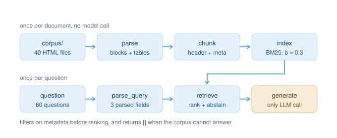

# FTEC5660 Homework 4 — retrieval for RAG over company reports

Lexical retrieval over 40 company documents (10 fictional companies × 4 document types).
`python hw4.py --data-folder public_test` scores **75.00 / 75** on the public set, with **0 model calls
of my own** — the only LLM call in the pipeline is the provided generator.

## Homework 4 solution



**Pipeline.** Documents are parsed into blocks, and every `<table>` goes through `table_to_text`:
one line per row, `label | header: value`, caption kept, so no figure loses its row and column.
Blocks are packed into chunks of at most 1500 characters that never separate a table row from its
label; each chunk starts with `company | FY | doc_type | section` and carries `source`, `company`,
`fiscal_year`, `doc_type` as metadata — that header is what lets a lexical index tell one company's
balance sheet from another's. The index is `BM25Okapi(b = 0.3)` over lower-cased, stopword-stripped,
stemmed tokens; `b = 0.3` stops short paragraphs outranking the income statement. `parse_query`
extracts company, fiscal year and document type, which filter the candidates *before* ranking; the
survivors are ranked per company, same-year report first, interleaved across companies and spread
across sections. `retrieve` returns `[]` — and the generator then answers `NOT_FOUND` — when a named
company is absent, the year is not covered, or the question asks for an attribute the corpus never
mentions. No embeddings, and no model calls anywhere except the fixed generator.

### Ablation

Each row adds one component to the row above; **V10 is the shipped code**, verified byte-identical
against `hw4.py` on all 40 documents and 60 questions. Every row makes **0 model calls** of its own, so
there is no cost column: the only LLM call in the pipeline is the generator, in Task 4. The script and
its artifacts are in [`ablation/`](ablation); full numbers in `ablation/ablation.csv`.

**Table 1.** The complete table: every configuration against every task. The last row is the shipped
code, and its numbers are exactly what `results.csv` contains — 100% recall, 100% abstention, 60/60
correct.

| Variant | Chunks | T1.1 | T1.2 | T2.2 parse | T2.1 non-empty | T2.3 recall@5 | T3 kept | T3 rejected | T4 accuracy | Points |
|---|---|---|---|---|---|---|---|---|---|---|
| B0 | 211 | 0.0% | 100.0% | 0.6% | 100.0% | 26.1% | 100.0% | 0.0% | 38.3% | 19.72 |
| V1 | 317 | 100.0% | 100.0% | 0.6% | 100.0% | 23.9% | 100.0% | 0.0% | 36.7% | 27.39 |
| V2 | 406 | 100.0% | 100.0% | 0.6% | 100.0% | 67.4% | 100.0% | 0.0% | 71.7% | 40.91 |
| V3 | 406 | 100.0% | 100.0% | 0.6% | 100.0% | 84.8% | 100.0% | 0.0% | 83.3% | 49.77 |
| V4 | 406 | 100.0% | 100.0% | 0.6% | 100.0% | 87.0% | 100.0% | 0.0% | 83.3% | 50.58 |
| V5 | 406 | 100.0% | 100.0% | 100.0% | 100.0% | 91.3% | 100.0% | 71.4% | 95.0% | 71.14 |
| V6 | 406 | 100.0% | 100.0% | 100.0% | 100.0% | 91.3% | 100.0% | 71.4% | 95.0% | 71.14 |
| V7 | 406 | 100.0% | 100.0% | 100.0% | 100.0% | 97.8% | 100.0% | 71.4% | 98.3% | 71.81 |
| V8 | 406 | 100.0% | 100.0% | 100.0% | 100.0% | 100.0% | 100.0% | 71.4% | 100.0% | 72.14 |
| V9 | 406 | 100.0% | 100.0% | 100.0% | 100.0% | 100.0% | 100.0% | 71.4% | 100.0% | 72.14 |
| **V10** | 406 | 100.0% | 100.0% | 100.0% | 100.0% | 100.0% | 100.0% | 100.0% | 100.0% | **75.00** |

**Table 2.** What each single change bought — one change per row, so each number is attributable to
that component alone.

| Variant | Change relative to the row above | What it bought |
|---|---|---|
| B0 | `get_text()` + `RecursiveCharacterTextSplitter`, whitespace tokens, `b = 0.75`, BM25 top-5 over the whole corpus, no parsing, never `[]` | — (baseline) |
| V1 | + block parsing and `table_to_text` | T1.1 0 → 100%. Recall *falls* 26.1 → 23.9: precise table chunks are still unidentifiable as belonging to the asked company |
| V2 | + chunk header `company \| FY \| doc_type \| section` | +13.5, the largest single lever: the company name is now inside every chunk, so a lexical score can separate the companies |
| V3 | + stopword-stripped, stemmed tokeniser | +8.9. Without it, "in"/"usd"/"millions" flatten every score difference |
| V4 | + `b = 0.3` instead of 0.75 | +0.8. Short paragraphs stop outranking the income statement |
| V5 | + `parse_query` and metadata filtering | +20.6. Ranking inside one company's documents drops the other nine companies as distractors: parse 0.6 → 100%, rejected 0 → 71.4%, recall 87.0 → 91.3 |
| V6 | + query expansion (`sales` → `revenue`, …) | 0.0. Within run-to-run noise; kept because it is free |
| V7 | + same-year report ranked first | +0.7 (recall 91.3 → 97.8). The FY2025 report names both the old and the new CFO |
| V8 | + per-company pools, interleaved | +0.3 (recall 97.8 → 100%). The last comparison misses were slot allocation, not ranking |
| V9 | + section diversity | 0.0 on `public_test`. Two-company comparisons never exhaust five slots; kept as a guard for a three-company comparison |
| V10 | + abstention (`[]` when the attribute never appears) | +2.9 (rejected 71.4 → 100%): the four questions that name a real company but ask for a figure it never discloses |

**Why the two flat rows stay.** A forward chain can only see whichever of two substitutes was added
first. `same_year` is worth +0.7 at V7 and **0.00** when removed from V10 — `per_company` does the same
job. `sections` is 0.00 in both directions on `public_test`; it stays because a three-company
comparison would otherwise spend a slot on a second chunk of the same section. Leave-one-out on V10:
only `parse` (−16.80) and `abstain` (−2.86) are load-bearing; `per_company` costs 2.2 points of recall
but no Task 2.3 points, because that score saturates at 90% recall.

**Table 3.** LLM reranking, measured on its own (`python ablation/ablation.py --rerank-side`). It is not
in the chain because `hw4.py` does not rerank:

| Configuration | recall@5 | kept | rejected | LLM calls | Time |
|---|---|---|---|---|---|
| V4, no rerank | 87.0% | 100% | 0.0% | 0 | 0.6 s |
| V4 + rerank top-20 | 97.8% | 100% | 0.0% | 60 | 55.3 s |
| V4 + rerank top-40 | 100.0% | 100% | 0.0% | 60 | 61.6 s |

A reranker can **replace** metadata filtering on recall — but it can never abstain (`rejected` stays
0%, so Task 3 collapses) and costs 60 calls and ~55 s against none. The deterministic filter wins on
both, which is why the shipped pipeline has no reranker. Appended *after* filtering it ties exactly
(recall is already 100%): there is no headroom left for it to recover.

### Error analysis

`ablation/ablation_errors.csv` lists all 123 failures across the chain. B0 fails 37 of 60 — 20 table
questions and 12 comparisons — because `get_text()` destroys the cell-to-label link, so the generator
sees `492.1` with no "accounts receivable" beside it. At V5 only four remain, and all four are comparisons:
the five slots are spent inside one company's pool, so there is nothing to compare against. Same-year
ordering (V7) fixes three of them by floating both companies' current-year reports to the top;
per-company interleaving (V8) fixes the last, q013, which confuses Brightwater Energy with Brightwater
Software. From V8 onward there are none. Filtering already rejects 10 of the 14 unanswerable questions
mechanically and the generator catches the other four itself, which is why the abstention rule at V10
is worth +2.9 rather than the full 10 points.

## Reproduce

```bash
python hw4.py --data-folder public_test                 # 75.00/75, writes results.csv
python ablation/ablation.py --answers all               # Tables 1-2, ~$0.15
python ablation/ablation.py --answers none              # retrieval metrics only, free
python ablation/ablation.py --rerank-side               # Table 3, ~120 calls
```

## Reflection

Task 6: [Reflection.pdf](Reflection.pdf).

## Submission

Repository contents, per Section 10:

- `hw4.py` — the five functions; nothing below "Provided code below" is changed
- `requirements.txt` — no extra packages beyond the starter's
- `README.md` — this report, with `pipeline.svg` as its figure
- `results.csv` — the public-test output
- `ablation/ablation.py` — the Task 5 script; it also writes everything else in `ablation/`
- `ablation/ablation.csv`, `ablation/ablation_table.md`, `ablation/ablation_errors.csv`, `ablation/ablation_rerank.csv`, `ablation/ablation_rerank.md` — the numbers behind Tables 1–3
- `Reflection.pdf` — Task 6

No API key is committed (`.env` is gitignored), no index files are committed, and the repository is public.
